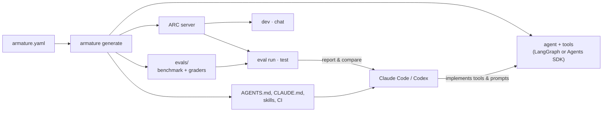

<div align="center">

<h1>Armature</h1>

<h3>Spec in, agent project out. Benchmark first.</h3>

<p>
Compile one <code>armature.yaml</code> into a framework-native Python agent for LangGraph or the
OpenAI Agents SDK, with an eval benchmark, tests, CI and a coding-agent handoff kit, all generated
before you write the agent itself.
</p>

[](https://github.com/gnsepili/armature/actions/workflows/ci.yml)
[](LICENSE)
[](https://nodejs.org)
[](https://www.python.org)
[](#status-and-roadmap)

[Quickstart](#quickstart) ·
[How it works](#how-it-works) ·
[Features](#features) ·
[CLI reference](docs/cli.md) ·
[Design decisions](docs/adr/) ·
[Contributing](CONTRIBUTING.md)

</div>

---

An armature is the frame a sculptor builds before adding clay. Armature builds that frame for an
AI agent: a plain Python project that runs on day one, a server that speaks one runtime
contract, and a benchmark written **before** the agent exists. Your coding agent (Claude Code,
Codex) adds the clay, and the benchmark tells you whether it worked.

```bash
npx armature-agents init support-bot
```

> [!NOTE]
> Armature is in **alpha**. The CLI, the generated project layout and the eval format are
> versioned contracts, but expect them to move before 1.0. Every change is recorded as an
> [ADR](docs/adr/).

## Why Armature

- **No lock-in.** The output is ordinary LangGraph or OpenAI Agents SDK code. Generated projects
  never import an Armature package; delete Armature and the project still runs.
- **Evals before code.** Every project starts with a seed benchmark, graders and gates. Cases
  are `DRAFT_UNVERIFIED` until a person reviews them, and drafts never gate a release.
- **Runs offline from minute one.** A bundled mock model drives the playground, the tests and
  the smoke suite, so CI needs no API key and costs nothing.
- **One contract for every framework.** The generated server speaks ARC, so the playground,
  chat, eval runner and conformance suite behave the same whichever framework you pick.
- **Built to hand off.** `AGENTS.md`, `CLAUDE.md` and task skills tell a coding agent how to
  implement against the benchmark without gaming it.
- **Safe to regenerate.** Change the spec and run `armature generate`. Managed files update;
  files you own or edited are never overwritten.

## Quickstart

You need Node 22+ and [uv](https://docs.astral.sh/uv/) (it installs Python 3.11–3.13 for the
generated project).

```bash
# 1. Generate a project with two tools; the write tool requires human approval.
npx armature-agents init support-bot --yes \
  --tool lookup_order:read:order_id \
  --tool issue_refund:write:order_id,amount
cd support-bot

# 2. Install and run it on the mock model. No key needed.
uv sync --extra dev
npx armature-agents dev --offline     # web playground
npx armature-agents test              # golden scaffold, unit tests, ARC conformance

# 3. Point it at a real model.
cp .env.example .env                  # add OPENAI_API_KEY or ANTHROPIC_API_KEY
npx armature-agents doctor --probe    # one paid call to confirm the key and model
npx armature-agents dev
```

Run `npx armature-agents init` with no flags for an interactive wizard.

## How it works



1. **Spec.** `armature.yaml` declares the framework, model, tools and their side effects,
   memory, approvals and output type. It is validated against a
   [JSON Schema](schemas/armature.schema.json), so editors autocomplete it.
2. **Compile.** Armature checks the spec against pinned, verified framework versions and models,
   then renders the project deterministically: the same spec and CLI version always give the same
   bytes. A lockfile records which files Armature manages.
3. **Benchmark.** `armature eval plan` shows coverage and what is left to do. Grow the `dev`
   suite, review each case, then `armature eval freeze`. Every later report says whether the
   cases changed since the freeze.
4. **Build.** Open your coding agent in the project. The `build-agent` skill implements tools and
   prompts one change at a time and runs `armature eval run` after each.
5. **Prove it.** `armature eval compare` diffs two runs with bootstrap confidence intervals.
   Gates fail the run on critical cases or task-success regressions.

## Features

### A spec you can read

```yaml
schema_version: 1
name: support-bot
runtime:
  framework: langgraph # or openai-agents
  pattern: single_agent_tools
model:
  provider: openai # openai | anthropic | openai_compatible
  id: gpt-6.1-sol
capabilities:
  custom_tools:
    - name: lookup_order
      side_effect: read
      args: [{ name: order_id }]
    - name: issue_refund
      side_effect: write # write and destructive tools pause for approval
      args: [{ name: order_id }, { name: amount }]
```

### A real project, not a template dump

<details>
<summary>What <code>init</code> generates</summary>

```text
support-bot/
├── armature.yaml              # the spec
├── pyproject.toml             # pinned framework versions, managed by uv
├── src/support_bot/
│   ├── agent.py               # framework-native agent
│   ├── tools/                 # one file per tool; yours to implement
│   ├── prompts/system.md      # yours to edit
│   └── runtime/               # ARC server, runner, approvals, structured output
├── tests/                     # ARC, guardrail and tool tests on the mock model
├── evals/
│   ├── evalspec.yaml          # objectives, suites, gates
│   ├── cases/{smoke,dev}/     # seed cases, DRAFT_UNVERIFIED
│   └── fixtures/              # reference answers
├── docs/                      # spec, architecture, tool contracts, build status
├── AGENTS.md  CLAUDE.md       # instructions for coding agents
├── .agents/skills/            # build-agent, add-tool, build-benchmark, optimize-agent, debug-run
└── .github/workflows/armature.yml
```

</details>

Tool bodies, prompts and the project README are written once and then belong to you.
Everything else is managed: `armature generate` keeps it in sync with the spec, and skips any
managed file you edited by hand.

### Evals that are hard to fool

```text
$ armature eval plan
objective   task_success; diagnostics: tool_correctness, orchestration, safety, efficiency

suites
  smoke        2 case(s)  offline, 1 trial(s)
             trust: 2 DRAFT_UNVERIFIED
             categories: contract 2
  dev          2 case(s)  any, 3 trial(s)
             trust: 2 DRAFT_UNVERIFIED
             categories: adversarial 1, ambiguous 1; 1 critical
  regression   0 case(s)  any, 1 trial(s) (missing)
  heldout      0 case(s)  any, 3 trial(s), aggregate only (missing)

gates       critical failures allowed 0; max task-success regression 0.05
freeze      not frozen

next
  - grow the dev suite to 20 cases (has 2)
  - review 4 case(s) and set `trust: VERIFIED`
  - freeze the reviewed benchmark: `armature eval freeze`
```

- Static lint catches graders that check nothing, unknown tools, duplicate inputs, and case
  wording that leaks into the system prompt or tool descriptions.
- Multiple trials per case, with bootstrap confidence intervals, so a lucky run is not a win.
- A held-out suite kept outside the repo reports aggregates only, so it can catch overfitting.
- Offline runs are labelled `MOCK`: they prove the wiring, not the quality.
- Live runs stop at `--max-cost`.

### Scriptable by default

Every command takes `--json` and runs without a terminal, which makes Armature easy to drive
from CI or from a coding agent. Exit codes are part of the contract:

| Code | Meaning           | Code | Meaning               |
| ---- | ----------------- | ---- | --------------------- |
| `0`  | ok                | `3`  | refused to overwrite  |
| `1`  | validation failed | `4`  | eval gate failed      |
| `2`  | unsupported       | `5`  | environment not ready |

## Supported today

|                | LangGraph                            | OpenAI Agents SDK         |
| -------------- | ------------------------------------ | ------------------------- |
| Pinned version | `langgraph` 1.2.21                   | `openai-agents` 0.24.0    |
| Providers      | OpenAI, Anthropic, OpenAI-compatible | OpenAI, OpenAI-compatible |
| Session memory | in-memory, SQLite                    | in-memory, SQLite         |
| Tool approvals | ✓                                    | ✓                         |
| Typed output   | ✓                                    | ✓                         |
| Pattern        | `single_agent_tools`                 | `single_agent_tools`      |

Versions and model IDs are pinned to what was installed and tested, in
[`versions.json`](packages/core/catalog/versions.json) and
[`models.json`](packages/core/catalog/models.json). Other models work with `--experimental` and
report cost as not measured.

## Commands

| Command                                                       | What it does                                                            |
| ------------------------------------------------------------- | ----------------------------------------------------------------------- |
| `init`                                                        | Wizard or flags → `armature.yaml` and a generated project               |
| `generate`                                                    | Re-render managed files from the spec                                   |
| `plan`                                                        | Show the spec, architecture, compatibility status and open tasks        |
| `sync`                                                        | Refresh the coding-agent handoff kit only                               |
| `dev` / `chat`                                                | Local web playground / terminal chat against the running app            |
| `doctor`                                                      | Toolchain, pins and secrets; `--conformance`; `--probe` (one paid call) |
| `test`                                                        | Golden scaffold, generated unit tests, ARC conformance                  |
| `eval plan \| validate \| run \| report \| compare \| freeze` | The benchmark loop                                                      |

Full flags and examples are in the [CLI reference](docs/cli.md).

## FAQ

<details>
<summary><b>Is Armature an agent framework?</b></summary>

No. It generates code for existing frameworks and then gets out of the way. There is no
Armature runtime, hosted service or LLM wrapper in your project.

</details>

<details>
<summary><b>How is this different from a project template?</b></summary>

A template is copied once. Armature keeps a lockfile of the files it manages, so you can change
the spec months later and regenerate without losing your work. It also checks the spec against
verified framework versions, and ships a benchmark, a conformance suite and CI that agree with
the code it generated.

</details>

<details>
<summary><b>Do I need an API key to try it?</b></summary>

No. `dev --offline`, `test` and the smoke suite run on a scripted mock model. You need a key only
for live runs and `doctor --probe`.

</details>

<details>
<summary><b>What does Armature not do for me?</b></summary>

It does not write your real tool implementations, manage credentials, or make security
decisions. The generated server binds to `127.0.0.1`; authentication and deployment are yours.
See [SECURITY.md](SECURITY.md).

</details>

<details>
<summary><b>Can I stop using Armature?</b></summary>

Yes. Delete `armature.yaml` and `armature.lock` and you have a normal Python project.

</details>

## Status and roadmap

Armature 0.1 covers one agent with tools. Next up:

- [ ] workflow and supervisor patterns
- [ ] more frameworks
- [ ] MCP servers as agent tools
- [ ] live-eval CI with stored baselines

Have a use case that doesn't fit? [Open an issue](https://github.com/gnsepili/armature/issues/new/choose).

## Contributing

Bug reports, framework expertise and eval cases are all welcome. Start with
[CONTRIBUTING.md](CONTRIBUTING.md). The short version:

```bash
pnpm install
pnpm test                 # unit tests
pnpm test:integration     # generates, installs and tests real projects; needs uv
pnpm typecheck && pnpm lint
```

Coding agents should read [AGENTS.md](AGENTS.md) first. Public contracts change only through an
[ADR](docs/adr/).

## License

[Apache-2.0](LICENSE). Report security issues privately; see [SECURITY.md](SECURITY.md).
